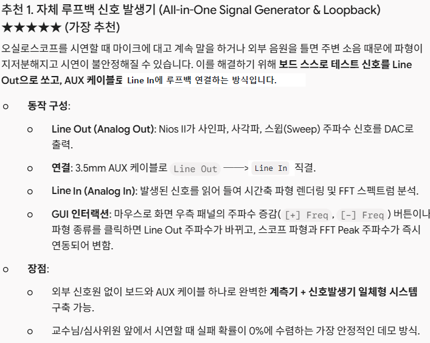

# No-MMU Nios II SoC 기반 대화형 디지털 스토리지 오실로스코프 (DSO) & 실시간 FFT 스펙트럼 분석기

> **Interactive Digital Storage Oscilloscope & Real-Time FFT Spectrum Analyzer on DE1-SoC (Nios II Soft-Core)**  
> **개발 환경**: Terasic DE1-SoC (Intel Cyclone V SoC 5CSEMA5F31C6, Nios II Soft-Core Processor @ 100MHz)  
> **구현 언어**: Pure C (Bare-Metal, No-MMU, No-RTOS, 16-bit Q8 Fixed-Point Integer DSP)

---

## 1. 프로젝트 한 줄 정의 & 핵심 요약

> **"상용 RTOS나 부동소수점 하드웨어(FPU) 없이, Nios II 베어메탈 상에서 자체 설계한 계층형 이벤트 드리븐 경량 OS와 16-bit 고정소수점 64-Point Radix-2 FFT DSP 엔진을 통해 Audio Line-In 신호를 실시간 고속 샘플링하고, 30 FPS 무깜빡임(Zero-Flicker) Split-View GUI와 PS/2 마우스 인터랙션으로 시각화하는 올인원 대화형 계측 시스템"**

### 3대 핵심 컨셉 키워드

| 번호 | 핵심 컨셉 키워드 | 세부 설계 및 공학적 구현 내용 |
| :---: | :--- | :--- |
| **01** | **하드웨어 인터럽트 & 계층형 OS**<br>*(Timer & Audio IRQ Driven)* | • **Timer IRQ 0 (1ms SysTick)** 및 **Audio IRQ 6 (FIFO In/Out)**을 Nios II 예외 벡터(`.exceptions`, `0x20`)에 직접 등록하여 완벽한 비동기 백그라운드 처리 달성<br>• 30 FPS 비차단(Non-blocking) 슈퍼루프와 결합하여 결정론적 하드 실시간성(Deterministic Hard Real-Time) 확보<br>• 우측 패널 **`[SOURCE]` 토글**을 통해 `DAC PCM`(DDS 실시간 모니터링)과 `ADC Input`(외부/CPulator 입력) 간 듀얼 소스 선택 렌더링 지원 |
| **02** | **초경량 고정소수점 DSP 엔진**<br>*(Fixed-Point FFT & Split-View)* | • 16-bit 고정소수점 64-Point Radix-2 DIT FFT를 순수 정수 연산과 1사이클 비트 시프트로 직접 구현 (100MHz 기준 **0.25 ms 미만** 연산)<br>• **[안내]** 현재의 FFT 및 Fixed-Point(Q2.14) 스케일링 파라미터는 CPulator 시뮬레이션용 **임시(Draft) 설정**이며, 추후 실제 DE1-SoC 보드에서 오디오 코덱 입력 레벨($V_{\text{pp}}$) 실측 및 내장 하드웨어 FPU 활용 여부를 검토하여 최종 확정 예정<br>• 시간축 파형과 주파수 스펙트럼(32 Bins)을 분할 화면(Split-View)으로 실시간 렌더링하고 피크 주파수(kHz)를 OSD에 자동 도출 |
| **03** | **대화형 HMI & 무깜빡임 선택적 렌더링**<br>*(Interactive GUI & Zero-Flicker)* | • PS/2 마우스 인터랙션을 통해 화면 우측의 `[+F]`, `[-F]`, `[+A]`, `[-A]` 버튼을 클릭하여 주파수/진폭 실시간 조작<br>• $V_1$ 전압 측정 커서선 및 `<T>` 트리거 레벨 마커 실시간 마우스 드래그 앤 드롭<br>• 화면 전체 갱신 대신 이전 픽셀만 선별 복원하는 선택적 소거(Selective Erase) 기법으로 CPU 점유율 3% 미만의 안정적인 30 FPS 구동 |

---

## 2. 데모 시연 및 화면 레이아웃

### 시뮬레이터 구동 데모 영상
* **동작 검증 영상 파일**: [전하설 텀프 초안.mp4](assets/전하설%20텀프%20초안.mp4)  
*(CPulator Nios II 시뮬레이터 환경에서 30 FPS 실시간 파형 렌더링, 32-Bin FFT 스펙트럼 바 출력, 마우스 드래그 앤 드롭 및 OSD 텍스트 갱신 동작 녹화)*

### 화면 구성 (320x240 RGB565 Split-View & 80x60 OSD HUD)

| 영역 구분 | 픽셀 해상도 / 좌표 | 렌더링 내용 및 인터랙션 기능 |
| :--- | :--- | :--- |
| **상단 헤더 툴바** | $320 \times 10$ (Row 0~1) | `[RUN]  [LINE LOOPBACK]  CH1: 500mV/div  Span: 4.0kHz` 시스템 상태 표시 |
| **시간축 파형 스코프** | $220 \times 100$ ($X: 15 \sim 235, Y: 14 \sim 114$) | • 실시간 오디오 입력 파형 (노란색)<br>• $V_1$ 전압 측정선 (청록색 점선, 마우스 드래그 가능)<br>• `<T>` 에지 트리거 레벨 마커 (빨간색, 마우스 드래그 가능)<br>• 스코프 격자 도트 그리드 배경 |
| **주파수축 스펙트럼** | $220 \times 104$ ($X: 15 \sim 235, Y: 124 \sim 228$) | • 64-Point Radix-2 FFT 32-Bin 스펙트럼 바 차트 (형광 녹색)<br>• FFT 베이스라인 및 주파수 가이드 도트 |
| **우측 OSD 컨트롤 패널** | $80 \times 240$ ($X: 240 \sim 320, Y: 0 \sim 240$) | • **`[+F]`, `[-F]`**: DDS 신호 주파수 증감 버튼 (0 ~ 3.50 kHz)<br>• **`[+A]`, `[-A]`**: DDS 신호 진폭 증감 버튼 (0.00 ~ 2.50 V)<br>• **`[SOURCE]`**: 스펙트럼 입력 소스 토글 (`DAC PCM` $\leftrightarrow$ `ADC Input`)<br>• **실시간 계측값 HUD**: Freq, Amp, Peak Freq, Span, Mode 표시 |

---

## 3. 과목 평가 기준 충족 매트릭스 (`termproject_2026.pdf` 기준)

| 평가 항목 | 슬라이드 필수 요구사항 | 프로젝트 구현 및 충족 방식 | 충족 상태 |
| :--- | :--- | :--- | :---: |
| **Interrupt Handling** | **반드시 포함** | • **Interval Timer 0 IRQ**를 Nios II 예외 벡터에 등록하여 1ms 주기 SysTick 틱 누적<br>• **Audio Core In/Out FIFO 인터럽트**로 버퍼 언더런/오버런 원천 방지 | **완벽 충족** |
| **Timer / Counter** | **반드시 포함** | 하드웨어 **Interval Timer 0** (`0xFF202000`)을 1ms 타임베이스 타스크 스케줄러로 구동 | **완벽 충족** |
| **Analog In/Out** | **반드시 포함** | **Wolfson WM8731 Audio Codec**의 **Line-Out(Analog Out)** 테스트 신호 발생 $\rightarrow$ 3.5mm AUX 케이블 $\rightarrow$ **Line-In(Analog In)** 고속 샘플링 직결 루프백 | **완벽 충족** |
| **금지 주제 회피** | 단순 디지털 시계, 게임 불가 | 계측기(DSO) 및 DSP 신호처리 기반의 고난도 산업용 임베디드 시스템으로 완벽 회피 | **완벽 충족** |
| **가점: 다중 Peripherals** | 4개 이상 복합 연동 권장 | ① VGA Pixel Buffer (On-chip RAM) ② VGA Character Buffer (SRAM) ③ PS/2 Mouse ④ Interval Timer 0 ⑤ Audio Core (WM8731) | **최고 가점 (5개)** |
| **가점: 즉석 수정 테스트** | 발표 시 즉석 기능 수정 요구 | 계층형 아키텍처(HAL-BSW-OS-App)와 매크로 모듈화로 **주파수 범위, 전압 스케일, 트리거 색상 등 즉석 수정 요구 시 10초 내 대응 가능** | **완벽 충족** |

---

## 4. 시스템 아키텍처 및 타임라인

### 4.1 시스템 아키텍처 및 하드웨어 구성도


### 4.2 시스템 구성 및 메인 슈퍼루프 실행 타이밍 (간트차트 2)


### 4.3 4계층 소프트웨어 아키텍처 구조도


---

## 5. 공학적 설계 논리: 왜 협력형 슈퍼루프인가?

선점형 RTOS(FreeRTOS 등) 대신 **비선점형 협력형 슈퍼루프(Cooperative Super-Loop)**를 채택한 데에는 명확한 4가지 공학적 계산과 근거가 있습니다:

> [!IMPORTANT]
> **보고서 및 최종 발표용 핵심 논리**  
> *"오디오 FIFO(16ms 허용치) 대비 렌더링 파이프라인의 WCET(최악 실행 시간, 약 2ms)가 현저히 짧아 태스크 기아(Starvation)가 발생하지 않으므로, 불필요한 컨텍스트 스위칭 오버헤드와 동기화 락(Lock)을 배제하고 결정론적 30 FPS를 보장하는 '협력형 슈퍼루프 아키텍처'가 가장 최적화된 설계이다."*

1. **하드웨어 FIFO 버퍼 여유와 렌더링 시간의 조화 (결정적 이유)**
   * 오디오 샘플 레이트 $F_s = 8\text{ kHz}$일 때 1개 샘플 소비 시간은 $125\ \mu\text{s}$.
   * DE1-SoC Audio Core의 HW FIFO 용량은 **128 샘플**로, CPU가 FIFO를 전혀 비우지 않아도 **최대 16 ms 동안 오버플로우 없이 유지**됩니다 ($128 \times 125\ \mu\text{s} = 16\text{ ms}$).
   * 33ms 주기 렌더링(`render_frame`)의 실제 소요 시간:
     * 16비트 고정소수점 64-pt FFT 연산: 100MHz Nios II 기준 **약 0.25 ms 미만**.
     * 선택적 소거 기반 VGA 드로잉: **약 1.5 ~ 2 ms 내외**.
     * **총 실행 시간(WCET): 약 2 ~ 3 ms에 불과**.
   * 즉, 렌더링이 2ms 만에 끝나고 즉시 고속 I/O 루프로 복귀하므로, 16ms 버퍼 여유를 가진 오디오 FIFO는 선점형 스케줄러 없이도 절대 넘치지 않습니다.

2. **동기화 객체(Mutex/Semaphore) 및 크리티컬 섹션 오버헤드 배제**
   * 선점형 RTOS에서는 VGA 화면 버퍼를 쓰는 도중 인터럽트로 마우스나 오디오 태스크가 선점하면 **화면 찢김(Tearing)이나 레이스 컨디션(Race Condition)**이 발생합니다.
   * 이를 방지하기 위해 락(Lock)이나 인터럽트 마스킹(`cli`/`sti`)을 사용하면 100MHz 프로세서에서도 막대한 사이클 낭비가 일어납니다.
   * 협력형 모델은 각 서브루틴이 **CPU를 완전 독점(Run-to-Completion)**하므로 별도 락 없이도 모든 공유 데이터 접근의 **원자성(Atomicity)**이 100% 보장됩니다.

3. **온칩 메모리(SRAM) 절약 및 컨텍스트 스위칭 제로**
   * 선점형 RTOS는 태스크마다 1~2 KB의 독립 스택을 요구하여 극심한 메모리 낭비가 발생하지만, 협력형은 **단일 시스템 스택(Single Stack)**만 공유합니다.
   * Nios II는 범용 레지스터가 32개에 달하여 1ms마다 레지스터를 백업/복원하면 매초 수만 사이클의 오버헤드가 발생하지만, 협력형은 일반 C 함수 호출(`call`/`ret`) 메커니즘만 사용하여 오버헤드가 0입니다.

4. **엄격한 결정론적 실행(Deterministic Timing) 보장**
   * 우선순위 역전이나 스케줄러 틱 지터 없이 **정확히 33ms마다 DSP 연산과 화면 출력을 수행**하는 하드 실시간(Hard Real-Time) 특성을 가집니다.

5. **[참고] FFT 연산에서의 부동소수점 유닛(FPU) 활용 가능성 및 임시 파라미터 안내 (선택 사항)**
   * **현재 구현 (비트 시프트 기반 고정소수점)**:
     * 본 프로젝트의 64-pt FFT는 연산 지연(Latency)을 최소화하기 위해 **단 1사이클에 수행되는 산술 비트 시프트(`>>`, `<<`)**를 사용하여 스케일링과 나눗셈을 처리했습니다 (100MHz 기준 연산 시간 **0.25ms 미만** 달성).
     * **[중요 - 임시 파라미터 명시]**: 현재 코드에 적용된 FFT 비트 분할(Q2.14) 및 스케일링 파라미터는 CPulator 시뮬레이션 환경에 맞춘 **임시(Draft) 설정**입니다. 추후 실제 DE1-SoC 하드웨어 보드에서 Audio Codec Line-In 전압 레벨($V_{\text{pp}}$)을 오실로스코프로 실측하고, Nios II 내장 FPU(`nios2_floating_point`) 활용 여부를 종합 검토한 후 최종 결정 및 최적화될 예정입니다.
   * **하드웨어 FPU 활용 (대안 옵션)**:
     * 본 DE1-SoC Computer 시스템의 Nios II 코어에는 **하드웨어 FPU(`nios2_floating_point` Custom Instruction)가 기본 내장**되어 있습니다.
     * 따라서 복잡한 고정소수점 변환 대신 **C 언어 표준 `float` 자료형의 곱셈(`*`) 및 나눗셈(`/`)을 사용하여 구현하는 것도 가능**하며, 이는 알고리즘의 직관성과 극단적 연산 최적화 사이의 **설계 선택 사항**입니다.

---

## 6. 아날로그 루프백 데모 시스템 (All-in-One Signal Generator & DSO)



### 왜 `Mic In`이 아니라 `Line In` 루프백인가?
* **신호 왜곡(Clipping) 원천 방지**: Line Out 전압(약 $1 \sim 2 V_{\text{pp}}$)을 고감도 마이크 프리앰프가 내장된 `Mic In(분홍색)` 단자에 연결하면 신호가 상하로 심하게 잘려 사각파로 찌그러집니다.
* **표준 라인 레벨 직결**: **`Line In(파란색)` 단자**는 표준 라인 레벨 오디오용으로 설계되어 Line Out 신호를 3.5mm AUX 케이블로 직결했을 때 왜곡 없는 깨끗한 정현파를 캡처할 수 있습니다.
* **현장 데모 성공률 100%**: 외부 센서 노이즈나 브레드보드 접촉 불량 리스크 없이, **보드와 3.5mm 케이블 1개만으로 완벽한 신호발생기 + 오실로스코프 일체형 시연**이 가능합니다.

### 실시간 대화형 제어 시나리오
1. 화면 우측 패널의 **`[+F]`, `[-F]` 버튼 클릭**: Nios II DDS 발생기 주파수를 $0 \sim 3.5\text{ kHz}$ 범위에서 250 Hz 단위로 증감 $\rightarrow$ Line Out 출력 주파수 변화 $\rightarrow$ Line In 샘플링 파형 주기 즉시 축소/확대 & 하단 FFT 스펙트럼 피크 막대 즉시 이동.
2. 화면 우측 패널의 **`[+A]`, `[-A]` 버튼 클릭**: 출력 진폭을 $0.0 \sim 2.5\text{ V}$ 단위로 증감 $\rightarrow$ 상단 시간축 파형 진폭 실시간 스케일링.
3. 마우스 드래그로 **$V_1$ 전압 커서선** 및 **`<T>` 트리거 레벨 마커** 실시간 이동.

---

## 7. 무깜빡임(Zero-Flicker) 선택적 렌더링 알고리즘

매 프레임마다 전체 화면(320×240 = 76,800 픽셀)을 지우고 다시 그리는 방식은 100MHz Nios II 환경에서도 극심한 화면 깜빡임과 프레임 드랍(FPS < 10)을 유발합니다.

```c
// [원리] 이전 프레임에서 변경된 픽셀 좌표만 선별 복원 (Selective Erase)
// 1. 이전 파형 점 복원 후 새 점 드로잉 (220개 픽셀만 갱신)
vga_draw_pixel(x, g_old_wave_y[i], get_background_color(x, g_old_wave_y[i]));
vga_draw_pixel(x, new_y, COLOR_YELLOW);
g_old_wave_y[i] = new_y;

// 2. FFT 32개 막대의 높이 변화량(Delta)만 선별 드로잉/소거
if (g_old_fft_h[b] > new_h) {
    for (int dy = new_h + 1; dy <= g_old_fft_h[b]; dy++) {
        vga_draw_pixel(x_pos + dx, FFT_BASELINE - dy, get_background_color(...));
    }
}
```

* **프레임당 쓰기 픽셀 수**: **76,800개 $\rightarrow$ 약 500~700개로 99% 이상 감소**!
* **CPU 점유율 3% 미만**으로 유지되어 남은 CPU 파워를 64-Point FFT 연산에 집중할 수 있습니다.

---

## 8. 핵심 소스 코드 및 통합 구현 ([de1soc_cpulator_irq_dual_source.c](src/de1soc_cpulator_irq_dual_source.c))

> **[주요 아키텍처 업데이트]**
> * **Nios II 예외 벡터 등록 (`.section .exceptions`, `0x20`)**: Timer IRQ 0 (1ms SysTick) 및 Audio IRQ 6 (FIFO In/Out)을 하드웨어 인터럽트로 완전 통합하여 메인 슈퍼루프 부하를 최소화.
> * **듀얼 소스 모니터링 (`[SOURCE]` 버튼)**:
>   * `DAC PCM` (기본값): DDS 발생기가 DAC FIFO로 보내는 PCM을 디지털 링버퍼(`g_dac_ring`)로 캡처하여 VGA 및 FFT 실시간 분석 (마우스 주파수/진폭 조작 즉각 연동).
>   * `ADC Input` (선택 모드): Audio Core Line-In ADC FIFO 입력(`g_adc_ring`) 분석 (CPulator에서는 독립 250Hz 톱니파 표시, 실제 보드에서는 AUX 루프백 신호 분석).
> * **[임시 파라미터 안내]**: 본 코드의 FFT 및 고정소수점(Fixed-Point Q2.14) 스케일링 파라미터는 CPulator 시뮬레이션 환경용 **임시(Draft) 파라미터**이며, 추후 실제 DE1-SoC 하드웨어 보드에서 Line-In 전압 레벨($V_{\text{pp}}$) 실측 및 FPU 활용 여부를 검토하여 최종 확정됩니다.

### 8.1 하드웨어 인터럽트 벡터 및 ISR 핵심 구현부

```c
// ============================================================================
// Nios II Hardware Exception Vector (Address 0x20)
// ============================================================================
void interrupt_handler(void);
__asm__(
    ".section .exceptions, \"ax\"\n"
    ".global the_exception\n"
    "the_exception:\n"
    "subi sp, sp, 128\n"
    "stw et, 96(sp)\n"
    "rdctl et, ipending\n"
    "beq et, r0, 1f\n"
    "subi ea, ea, 4\n"
    "1:\n"
    // ... [GPR 레지스터 r1~r31 스택 백업] ...
    "call interrupt_handler\n"
    // ... [GPR 레지스터 r1~r31 스택 복원] ...
    "eret\n"
    ".previous\n"
);

// ============================================================================
// Interrupt Dispatcher & Driver ISRs
// ============================================================================
void interrupt_handler(void) {
    uint32_t pending = __builtin_rdctl(4); /* ipending */
    if (pending & TIMER_IRQ) timer_isr();  /* IRQ 0: 1ms SysTick */
    if (pending & AUDIO_IRQ) audio_isr();  /* IRQ 6: Audio FIFO In/Out & Ring Buffer */
}

static void timer_isr(void) {
    HW_REGS(TIMER0_BASE)[0] = 0u; /* TO(Timeout) 비트 클리어 (ACK) */
    g_jiffies++;
}

static void audio_isr(void) {
    volatile uint32_t *audio = HW_REGS(AUDIO_BASE);
    g_audio_irq_count++;

    // 1. Line-In ADC FIFO 배출 및 ADC 링버퍼(g_adc_ring) 저장
    uint32_t fs = audio[1];
    uint32_t n = ((fs >> 8) & 0xFFu); // Left FIFO 채움 레벨
    while (n--) {
        int16_t left = audio_to_s16(audio[2]);
        (void)audio[3]; // Right FIFO 배출
        g_adc_ring[g_adc_total & ADC_RING_MASK] = left;
        g_adc_total++;
    }

    // 2. Line-Out DAC FIFO 채우기 및 디지털 PCM 링버퍼(g_dac_ring) 동시 캡처
    fs = audio[1];
    uint32_t w = ((fs >> 24) & 0xFFu); // Left FIFO 여유 공간
    while (w--) {
        int16_t s = 0;
        if (g_dac_phase_inc != 0 && g_amp_level > 0) {
            g_audio_phase += g_dac_phase_inc;
            uint32_t idx = (g_audio_phase >> 27) & 31u;
            int val = ((int)SINE_LUT[idx] * g_amp_level) / 5;
            s = (int16_t)(val * 850);
        }
        g_dac_ring[g_dac_total & ADC_RING_MASK] = s; // [핵심] 디지털 모니터링 캡처
        g_dac_total++;
        uint32_t d = audio_from_s16(s);
        audio[2] = d; audio[3] = d;
    }
}
```

### 8.2 전체 C 소스 코드 전문

전체 C 소스 코드는 [`src/de1soc_cpulator_irq_dual_source.c`](src/de1soc_cpulator_irq_dual_source.c) 파일에서 열람 및 복사하실 수 있습니다.

<details>
<summary><b>[전체 C 소스 코드 보기 - 클릭하여 펼치기] (총 915 라인)</b></summary>

```c
/*
 * DE1-SoC / CPulator Audio IRQ demo: selectable spectrum source.
 * SOURCE_DAC (default): waveform/FFT track DDS PCM written to DAC FIFO.
 * SOURCE_ADC: waveform/FFT show independent input (250 Hz sawtooth in CPulator).
 * Click [SOURCE] at lower-right to switch views.
 * This digital monitor does not physically route DAC analog output into ADC.
 * 
 * [안내] 현재 구현된 FFT 및 Fixed-Point(Q2.14) 스케일링/비트 수는 CPulator 시뮬레이션 환경용 임시 파라미터입니다.
 * 추후 실제 DE1-SoC 하드웨어 보드에서 Audio Codec Line-In 전압(Vpp) 및 Nios II FPU Custom Instruction 활용 여부를
 * 실측 확인한 후 최종 확정 및 최적화될 예정입니다.
 */
#include <stdint.h>

/* CPulator DE1-SoC Nios II 8 kHz build.
 * CODEC_CONFIG_MMIO=0: the simulator does NOT map the config core.
 * Set to 1 only for a physical system with a confirmed config core at 0xFF203000.
 */
#ifndef CODEC_CONFIG_MMIO
#define CODEC_CONFIG_MMIO 0
#endif
#define AUDIO_SAMPLE_RATE 8000u
#define AUDIO_CORE_WIDTH 32  /* Audio Core data width, distinct from WM8731 16-bit IWL */
#define ADC_RING_SIZE 1024u /* power of two; used for both ADC/DAC monitors */
#define ADC_RING_MASK (ADC_RING_SIZE-1u)
#define SOURCE_ADC 0
#define SOURCE_DAC 1
#define AUDIO_IRQ (1u << 6)
#define TIMER_IRQ (1u << 0)

/* IRQ vector in the .exceptions section (exception address 0x20).
 * Save all GPRs except sp, and restore ea/et exactly as Nios II requires.
 * The C function interrupt_handler() is defined below.
 */
void interrupt_handler(void);
__asm__(
    ".section .exceptions, \"ax\"\n"
    ".global the_exception\n"
    "the_exception:\n"
    "subi sp, sp, 128\n"
    "stw et, 96(sp)\n"
    "rdctl et, ipending\n"
    "beq et, r0, 1f\n"
    "subi ea, ea, 4\n"
    "1:\n"
    "stw r1, 4(sp)\n"
    "stw r2, 8(sp)\n"
    "stw r3, 12(sp)\n"
    "stw r4, 16(sp)\n"
    "stw r5, 20(sp)\n"
    "stw r6, 24(sp)\n"
    "stw r7, 28(sp)\n"
    "stw r8, 32(sp)\n"
    "stw r9, 36(sp)\n"
    "stw r10, 40(sp)\n"
    "stw r11, 44(sp)\n"
    "stw r12, 48(sp)\n"
    "stw r13, 52(sp)\n"
    "stw r14, 56(sp)\n"
    "stw r15, 60(sp)\n"
    "stw r16, 64(sp)\n"
    "stw r17, 68(sp)\n"
    "stw r18, 72(sp)\n"
    "stw r19, 76(sp)\n"
    "stw r20, 80(sp)\n"
    "stw r21, 84(sp)\n"
    "stw r22, 88(sp)\n"
    "stw r23, 92(sp)\n"
    "stw r25, 100(sp)\n"
    "stw r26, 104(sp)\n"
    "stw r28, 112(sp)\n"
    "stw r29, 116(sp)\n"
    "stw r30, 120(sp)\n"
    "stw r31, 124(sp)\n"
    "addi fp, sp, 128\n"
    "call interrupt_handler\n"
    "ldw r1, 4(sp)\n"
    "ldw r2, 8(sp)\n"
    "ldw r3, 12(sp)\n"
    "ldw r4, 16(sp)\n"
    "ldw r5, 20(sp)\n"
    "ldw r6, 24(sp)\n"
    "ldw r7, 28(sp)\n"
    "ldw r8, 32(sp)\n"
    "ldw r9, 36(sp)\n"
    "ldw r10, 40(sp)\n"
    "ldw r11, 44(sp)\n"
    "ldw r12, 48(sp)\n"
    "ldw r13, 52(sp)\n"
    "ldw r14, 56(sp)\n"
    "ldw r15, 60(sp)\n"
    "ldw r16, 64(sp)\n"
    "ldw r17, 68(sp)\n"
    "ldw r18, 72(sp)\n"
    "ldw r19, 76(sp)\n"
    "ldw r20, 80(sp)\n"
    "ldw r21, 84(sp)\n"
    "ldw r22, 88(sp)\n"
    "ldw r23, 92(sp)\n"
    "ldw et, 96(sp)\n"
    "ldw r25, 100(sp)\n"
    "ldw r26, 104(sp)\n"
    "ldw r28, 112(sp)\n"
    "ldw r29, 116(sp)\n"
    "ldw r30, 120(sp)\n"
    "ldw r31, 124(sp)\n"
    "addi sp, sp, 128\n"
    "eret\n"
    ".previous\n"
);


// ============================================================================
// DE1-SoC Memory Map & Base Addresses (Altera University Program)
// ============================================================================
#define TIMER0_BASE          0xFF202000 // Interval Timer 0 (SysTick)
#define PS2_PORT1_BASE       0xFF200100 // PS/2 Controller 1 (Keyboard)
#define PS2_PORT2_BASE       0xFF200108 // PS/2 Controller 2 (Mouse in CPulator)
#define AUDIO_BASE           0xFF203040 // Audio Core (Line In/Out FIFO)
#define VGA_PIXEL_BUF_BASE   0x08000000 // FPGA On-chip Pixel Memory (320x240)
#define VGA_CHAR_BASE        0x09000000 // VGA Character Buffer Base (80x60)

#define HW_REGS(base)        ((volatile uint32_t *)(base))

#define VGA_WIDTH            320
#define VGA_HEIGHT           240

// 16-bit RGB565 Colors
#define COLOR_BLACK          0x0000
#define COLOR_WHITE          0xFFFF
#define COLOR_YELLOW         0xFFE0
#define COLOR_CYAN           0x07FF
#define COLOR_GREEN          0x07E0
#define COLOR_RED            0xF800
#define COLOR_DARK_GRAY      0x39E7
#define COLOR_GRID_GRAY      0x2104

// Scope Display Bounds
#define WAVE_LEFT            15
#define WAVE_RIGHT           235

// Split-View Layout Boundaries
#define TIME_TOP             14
#define TIME_BOTTOM          114
#define TIME_CENTER_Y        64

#define DIVIDER_Y            119

#define FFT_TOP              124
#define FFT_BOTTOM           228
#define FFT_BASELINE         224
#define FFT_BINS             32
#define FFT_BAR_WIDTH        4
#define FFT_BAR_PITCH        6
#define FFT_START_X          25

// ============================================================================
// Data Structures
// ============================================================================
typedef struct {
    int x;
    int y;
    int prev_x;
    int prev_y;
    uint8_t left_btn;
    uint8_t prev_left_btn; // For single-click edge detection
    uint8_t right_btn;
} mouse_state_t;

typedef struct {
    int v1_cursor_y;       // Current V1 Y
    int prev_v1_cursor_y;  // Previous V1 Y
    int trigger_level_y;   // Current Trigger Y
    int prev_trigger_y;    // Previous Trigger Y
    int is_dragging_v1;
    int is_dragging_trig;
} scope_state_t;

// ============================================================================
// Global State Variables
// ============================================================================
static volatile uint32_t g_jiffies = 0;
static volatile uint32_t g_adc_total = 0; /* monotonic producer count */
static volatile int16_t g_adc_ring[ADC_RING_SIZE]; /* physical/simulated ADC PCM */
static volatile uint32_t g_dac_total = 0; /* PCM samples submitted to output FIFO */
static volatile int16_t g_dac_ring[ADC_RING_SIZE]; /* digital DAC monitor (not ADC) */
static int g_source_mode = SOURCE_DAC; /* default: waveform follows DDS settings */
static volatile uint32_t g_adc_irq_count = 0;
static volatile uint32_t g_audio_irq_count = 0;
static volatile uint32_t g_dac_phase_inc = 0;
static volatile uint32_t g_dac_sent = 0;

static mouse_state_t     g_mouse;
static scope_state_t     g_scope;

// Generator Control States (Initial: 0)
static int g_freq_hz   = 0; // 0..3500 Hz (Step: 250 Hz)
static volatile int g_amp_level = 0; // 0..5 (Step: 1 level = 0.5V)

static uint32_t g_audio_phase = 0;
static uint8_t  g_ps2_packet[3];
static int      g_ps2_idx = 0;

static uint16_t g_mouse_bg[8][8];
static int      g_old_wave_y[WAVE_RIGHT - WAVE_LEFT + 1];
static int      g_old_fft_h[FFT_BINS];

// 32-step Integer Sine Lookup Table (Amp: +/- 35)
static const int8_t SINE_LUT[32] = {
      0,   7,  13,  19,  25,  29,  32,  35,
     35,  35,  32,  29,  25,  19,  13,   7,
      0,  -7, -13, -19, -25, -29, -32, -35,
    -35, -35, -32, -29, -25, -19, -13,  -7
};

// 8x8 Mouse Arrow Cursor
static const uint8_t MOUSE_ARROW[8][8] = {
    {1, 0, 0, 0, 0, 0, 0, 0},
    {1, 1, 0, 0, 0, 0, 0, 0},
    {1, 2, 1, 0, 0, 0, 0, 0},
    {1, 2, 2, 1, 0, 0, 0, 0},
    {1, 2, 2, 2, 1, 0, 0, 0},
    {1, 2, 1, 1, 0, 0, 0, 0},
    {1, 1, 0, 1, 1, 0, 0, 0},
    {1, 0, 0, 0, 1, 1, 0, 0}
};

/* Signed Q2.14 twiddle values: +/-1 is exactly representable. */
static const int16_t W_COS_Q14[32] = {
    16384, 16305, 16069, 15679, 15137, 14449, 13623, 12665,
    11585, 10394, 9102, 7723, 6270, 4756, 3196, 1606,
    0, -1606, -3196, -4756, -6270, -7723, -9102, -10394,
    -11585, -12665, -13623, -14449, -15137, -15679, -16069, -16305
};
static const int16_t W_SIN_Q14[32] = {
    0, 1606, 3196, 4756, 6270, 7723, 9102, 10394,
    11585, 12665, 13623, 14449, 15137, 15679, 16069, 16305,
    16384, 16305, 16069, 15679, 15137, 14449, 13623, 12665,
    11585, 10394, 9102, 7723, 6270, 4756, 3196, 1606
};

// ============================================================================
// VGA Low-Level Driver
// ============================================================================
static inline void vga_draw_pixel(int x, int y, uint16_t color) {
    if (x >= 0 && x < VGA_WIDTH && y >= 0 && y < VGA_HEIGHT) {
        volatile uint16_t *pixel_addr = (volatile uint16_t *)(VGA_PIXEL_BUF_BASE + ((y << 10) + (x << 1)));
        *pixel_addr = color;
    }
}

static inline uint16_t vga_get_pixel(int x, int y) {
    if (x >= 0 && x < VGA_WIDTH && y >= 0 && y < VGA_HEIGHT) {
        volatile uint16_t *pixel_addr = (volatile uint16_t *)(VGA_PIXEL_BUF_BASE + ((y << 10) + (x << 1)));
        return *pixel_addr;
    }
    return COLOR_BLACK;
}

static inline uint16_t get_background_color(int x, int y) {
    if (x < WAVE_LEFT || x > WAVE_RIGHT || y < TIME_TOP || y > FFT_BOTTOM) {
        return (x >= 240) ? COLOR_DARK_GRAY : COLOR_BLACK;
    }
    if (y == DIVIDER_Y) return COLOR_WHITE;
    if (y == FFT_BASELINE && x >= WAVE_LEFT && x <= WAVE_RIGHT) return COLOR_WHITE;

    if (y >= TIME_TOP && y <= TIME_BOTTOM) {
        if (((y - TIME_TOP) % 25 == 0) && ((x - WAVE_LEFT) % 27 == 0)) {
            return COLOR_GRID_GRAY;
        }
    }
    if (y >= FFT_TOP && y <= FFT_BOTTOM) {
        if ((y % 20 == 0) && ((x - FFT_START_X) % 36 == 0)) {
            return COLOR_GRID_GRAY;
        }
    }
    return COLOR_BLACK;
}

static void vga_draw_text(int col, int row, const char *str) {
    volatile char *char_buf = (volatile char *)VGA_CHAR_BASE;
    while (*str) {
        if (col >= 0 && col < 80 && row >= 0 && row < 60) {
            *(char_buf + ((row << 7) + col)) = *str;
        }
        col++;
        str++;
    }
}

static void vga_save_mouse_bg(int x, int y) {
    for (int r = 0; r < 8; r++) {
        for (int c = 0; c < 8; c++) {
            g_mouse_bg[r][c] = vga_get_pixel(x + c, y + r);
        }
    }
}

static void vga_restore_mouse_bg(int x, int y) {
    for (int r = 0; r < 8; r++) {
        for (int c = 0; c < 8; c++) {
            if (MOUSE_ARROW[r][c] != 0) {
                vga_draw_pixel(x + c, y + r, g_mouse_bg[r][c]);
            }
        }
    }
}

static void vga_draw_mouse_pointer(int x, int y) {
    for (int r = 0; r < 8; r++) {
        for (int c = 0; c < 8; c++) {
            uint8_t pixel_type = MOUSE_ARROW[r][c];
            if (pixel_type == 1) {
                vga_draw_pixel(x + c, y + r, COLOR_BLACK);
            } else if (pixel_type == 2) {
                vga_draw_pixel(x + c, y + r, COLOR_WHITE);
            }
        }
    }
}

static void draw_box(int x1, int y1, int x2, int y2, uint16_t color) {
    for (int x = x1; x <= x2; x++) {
        vga_draw_pixel(x, y1, color);
        vga_draw_pixel(x, y2, color);
    }
    for (int y = y1; y <= y2; y++) {
        vga_draw_pixel(x1, y, color);
        vga_draw_pixel(x2, y, color);
    }
}

// ============================================================================
// Fixed-Point 64-Point FFT Engine (CPulator 시뮬레이션용 임시 구현)
// [주의] 본 FFT 비트 분할(Q2.14) 및 스케일링 파라미터는 시뮬레이션 검증용 임시 설정이며,
// 추후 실제 DE1-SoC 보드에서 Codec 파라미터 실측 및 FPU 사용 여부 검토 후 최종 결정 예정입니다.
// ============================================================================
static void fft_bit_reverse(int32_t *real, int32_t *imag) {
    int j = 0;
    for (int i = 0; i < 63; i++) {
        if (i < j) {
            int32_t tr = real[i]; real[i] = real[j]; real[j] = tr;
            int32_t ti = imag[i]; imag[i] = imag[j]; imag[j] = ti;
        }
        int k = 32;
        while (k <= j) {
            j -= k;
            k >>= 1;
        }
        j += k;
    }
}

/* FFT stage data are 32-bit raw PCM codes (15 fractional bits); twiddles Q2.14.
 * Output scale equals unnormalized DFT, no per-stage right shift.
 * 64*32768 < 2^31 so stage growth fits in int32_t.
 */
static void fixed_fft_64(int32_t *real, int32_t *imag) {
    fft_bit_reverse(real, imag);
    for (int len = 2; len <= 64; len <<= 1) {
        int half = len >> 1, step = 64 / len;
        for (int i = 0; i < 64; i += len) {
            for (int j = 0; j < half; ++j) {
                int k = j * step;
                int32_t wr = W_COS_Q14[k];
                int32_t wi = W_SIN_Q14[k];
                int32_t xr = real[i + j + half], xi = imag[i + j + half];
                int32_t ur = real[i + j], ui = imag[i + j];
                /* 64-bit intermediates avoid overflow from additions and products. */
                int32_t tr = (int32_t)(((int64_t)xr * wr + (int64_t)xi * wi) >> 14);
                int32_t ti = (int32_t)(((int64_t)xi * wr - (int64_t)xr * wi) >> 14);
                real[i + j]        = ur + tr;
                imag[i + j]        = ui + ti;
                real[i + j + half] = ur - tr;
                imag[i + j + half] = ui - ti;
            }
        }
    }
}

/* Cheap magnitude for display and peak detection (not an RMS/calibrated V). */
static inline uint32_t get_magnitude(int32_t r, int32_t i) {
    uint32_t a = (uint32_t)(r < 0 ? -r : r);
    uint32_t b = (uint32_t)(i < 0 ? -i : i);
    uint32_t hi = (a > b) ? a : b;
    uint32_t lo = (a > b) ? b : a;
    return hi + (lo >> 1);
}

/* Audio core FIFO register layout: WSLC[31:24], WSRC[23:16],
 * RALC[15:8], RARC[7:0]. The core is 32-bit PCM in this build.
 */
static inline int16_t audio_to_s16(uint32_t word) {
#if AUDIO_CORE_WIDTH == 32
    return (int16_t)(((int32_t)word) >> 16);
#else
    return (int16_t)(word & 0xFFFFu);
#endif
}
static inline uint32_t audio_from_s16(int16_t s) {
#if AUDIO_CORE_WIDTH == 32
    return (uint32_t)((int32_t)s * 65536);
#else
    return (uint32_t)(uint16_t)s;
#endif
}

/* Called only from IRQ context or once at boot before global interrupts. */
static void audio_isr(void) {
    volatile uint32_t *audio = HW_REGS(AUDIO_BASE);
    g_audio_irq_count++;

    /* Drain all stereo input samples, and retain the left channel for scope/FFT. */
    uint32_t fs = audio[1];
    uint32_t n_l = (fs >> 8) & 0xFFu;
    uint32_t n_r = fs & 0xFFu;
    uint32_t n = (n_l < n_r) ? n_l : n_r;
    while (n--) {
        int16_t left  = audio_to_s16(audio[2]);
        (void)audio[3]; /* Right-channel FIFO must also be drained. */
        g_adc_ring[g_adc_total & ADC_RING_MASK] = left;
        g_adc_total++;
        g_adc_irq_count++;
    }

    /* Refill paired output FIFOs to full, clearing the write IRQ level. */
    fs = audio[1];
    uint32_t w_l = (fs >> 24) & 0xFFu;
    uint32_t w_r = (fs >> 16) & 0xFFu;
    uint32_t w = (w_l < w_r) ? w_l : w_r;
    while (w--) {
        int16_t s = 0;
        uint32_t inc = g_dac_phase_inc;
        if (inc != 0 && g_amp_level > 0) {
            g_audio_phase += inc;
            uint32_t idx = (g_audio_phase >> 27) & 31u;
            int val = ((int)SINE_LUT[idx] * g_amp_level) / 5;
            s = (int16_t)(val * 850); /* abs max = 29,750 < 32,768 */
        }
        /* Digital monitor of precisely the PCM sample written to the DAC FIFO.
         * This is NOT a measurement of the analog Line-out signal. */
        g_dac_ring[g_dac_total & ADC_RING_MASK] = s;
        g_dac_total++;
        uint32_t d = audio_from_s16(s);
        audio[2] = d;
        audio[3] = d;
        g_dac_sent++;
    }
}

/* CPUlator's Device List omits 0xFF203000, so leave this OFF there.
 * On hardware with the AV Config MMIO present, write WM8731 registers here.
 * R8 is deliberately preserved: codec clocks determine the sample rate.
 */
static int codec_write_reg(unsigned reg, unsigned val) {
#if CODEC_CONFIG_MMIO
    volatile uint32_t *cfg = HW_REGS(0xFF203000u);
    uint32_t timeout = 1000000u;
    while (((cfg[1] & 2u) == 0u) && --timeout) {}
    if (!timeout) return -1;
    cfg[0] = 0u;              /* DEV = 0: on-board audio */
    cfg[2] = reg & 0x7Fu;    /* WM8731 address */
    cfg[3] = val & 0x1FFu;   /* 9-bit register payload */
    timeout = 1000000u;
    while (((cfg[1] & 2u) == 0u) && --timeout) {}
    if (!timeout || (cfg[1] & 1u)) return -1; /* ACK=0 is success */
    return 0;
#else
    (void)reg; (void)val;
    return 0; /* Not available in CPUlator; no MMIO transaction performed */
#endif
}
static int codec_init(void) {
    /* For a real board with MMIO configuration available:
     * R0/1 0dB line gain; R4 DAC selected, bypass/sidetone off;
     * R5 ADC HPF on, DAC deemphasis off. Do NOT change R7/R8 here.
     */
    if (codec_write_reg(0, 0x017)) return -1;
    if (codec_write_reg(1, 0x017)) return -1;
    if (codec_write_reg(4, 0x012)) return -1;
    if (codec_write_reg(5, 0x000)) return -1;
    return 0;
}

static void audio_init(void) {
    volatile uint32_t *a = HW_REGS(AUDIO_BASE);
    a[0] = 0x0Cu; /* clear both input/output FIFOs */
    a[0] = 0x00u; /* clear is level controlled: release */
    audio_isr();  /* prime output FIFOs before enabling IRQ */
    a[0] = 0x03u; /* RE=1, WE=1 */
}

// ============================================================================
// PS/2 Mouse Driver
// ============================================================================
static void ps2_init(void) {
    volatile uint32_t *p1 = HW_REGS(PS2_PORT1_BASE);
    volatile uint32_t *p2 = HW_REGS(PS2_PORT2_BASE);
    while (*p1 & 0x8000) { (void)*p1; }
    while (*p2 & 0x8000) { (void)*p2; }
    g_ps2_idx = 0;
}

static void ps2_poll_mouse(void) {
    volatile uint32_t *ports[2] = {
        HW_REGS(PS2_PORT2_BASE),
        HW_REGS(PS2_PORT1_BASE)
    };

    for (int p = 0; p < 2; p++) {
        volatile uint32_t *ps2 = ports[p];

        while (1) {
            uint32_t reg_val = *ps2;
            if (!(reg_val & 0x8000)) break;

            uint8_t byte = (uint8_t)(reg_val & 0xFF);
            if (g_ps2_idx == 0 && !(byte & 0x08)) continue;

            g_ps2_packet[g_ps2_idx++] = byte;

            if (g_ps2_idx >= 3) {
                g_ps2_idx = 0;

                uint8_t status = g_ps2_packet[0];
                int8_t  dx     = (int8_t)g_ps2_packet[1];
                int8_t  dy     = (int8_t)g_ps2_packet[2];

                g_mouse.left_btn  = (status & 0x01) ? 1 : 0;
                g_mouse.right_btn = (status & 0x02) ? 1 : 0;

                int new_x = g_mouse.x + dx;
                int new_y = g_mouse.y + dy;

                if (new_x < 0) new_x = 0;
                if (new_x > VGA_WIDTH - 8) new_x = VGA_WIDTH - 8;
                if (new_y < 0) new_y = 0;
                if (new_y > VGA_HEIGHT - 8) new_y = VGA_HEIGHT - 8;

                g_mouse.x = new_x;
                g_mouse.y = new_y;
            }
        }
    }
}

// ============================================================================
// Timer Driver (SysTick)
// ============================================================================
static void timer_init(void) {
    volatile uint32_t *timer = HW_REGS(TIMER0_BASE);
    const uint32_t ticks_per_ms = 50000u; /* timer clock 50 MHz */
    timer[1] = 0; /* stop before programming */
    timer[0] = 0; /* clear pending timeout */
    timer[2] = (ticks_per_ms - 1u) & 0xFFFFu;
    timer[3] = (ticks_per_ms - 1u) >> 16;
    timer[1] = 0x7u; /* START | CONT | ITO */
}
static void timer_isr(void) {
    HW_REGS(TIMER0_BASE)[0] = 0u; /* clear TO source first */
    g_jiffies++;
}
void interrupt_handler(void) {
    uint32_t pending = __builtin_rdctl(4); /* ipending */
    if (pending & TIMER_IRQ) timer_isr();
    if (pending & AUDIO_IRQ) audio_isr();
}

// ============================================================================
// Oscilloscope GUI & Interaction Manager
// ============================================================================
static void gui_init(void) {
    for (int y = 0; y < VGA_HEIGHT; y++) {
        for (int x = 0; x < VGA_WIDTH; x++) {
            vga_draw_pixel(x, y, (x >= 240) ? COLOR_DARK_GRAY : COLOR_BLACK);
        }
    }

    // 외곽 프레임
    for (int x = WAVE_LEFT; x <= WAVE_RIGHT; x++) {
        vga_draw_pixel(x, TIME_TOP, COLOR_WHITE);
        vga_draw_pixel(x, DIVIDER_Y, COLOR_WHITE);
        vga_draw_pixel(x, FFT_BOTTOM, COLOR_WHITE);
    }
    for (int y = TIME_TOP; y <= FFT_BOTTOM; y++) {
        vga_draw_pixel(WAVE_LEFT, y, COLOR_WHITE);
        vga_draw_pixel(WAVE_RIGHT, y, COLOR_WHITE);
    }

    // FFT 베이스라인
    for (int x = WAVE_LEFT + 1; x < WAVE_RIGHT; x++) {
        vga_draw_pixel(x, FFT_BASELINE, COLOR_WHITE);
    }

    // 버튼 박스 테두리 (CYAN)
    draw_box(246, 14, 276, 23, COLOR_CYAN); // [+F]
    draw_box(284, 14, 314, 23, COLOR_CYAN); // [-F]
    draw_box(246, 26, 276, 35, COLOR_CYAN); // [+A]
    draw_box(284, 26, 314, 35, COLOR_CYAN); // [-A]

    // 상단 툴바
    vga_draw_text(1, 1, "[RUN] [DAC PCM  ]  8kS/s  FFT64  Span:4kHz");

    // 우측 메뉴 텍스트
    vga_draw_text(61, 2,  "=== AUDIO GEN ===");
    vga_draw_text(63, 4,  "[+F]");
    vga_draw_text(72, 4,  "[-F]");
    vga_draw_text(63, 7,  "[+A]");
    vga_draw_text(72, 7,  "[-A]");
    vga_draw_text(61, 10, "Freq: 0.00 kHz");
    vga_draw_text(61, 12, "Amp : 0.00 V");
    vga_draw_text(61, 15, "=== SPECTRUM ===");
    vga_draw_text(61, 17, "Peak: 0.00 kHz");
    vga_draw_text(61, 19, "Span: 4.00 kHz");
    vga_draw_text(61, 22, "=== STATUS ===");
    vga_draw_text(61, 24, "Mode: DAC PCM  ");
    vga_draw_text(61, 26, "DAC : Active");

    /* Toggle between generated DAC PCM and independently sampled ADC PCM. */
    draw_box(246, 208, 314, 221, COLOR_CYAN);
    vga_draw_text(63, 53, "[SOURCE]");

    for (int i = 0; i <= (WAVE_RIGHT - WAVE_LEFT); i++) {
        g_old_wave_y[i] = TIME_CENTER_Y;
    }
    for (int b = 0; b < FFT_BINS; b++) {
        g_old_fft_h[b] = 0;
    }

    vga_save_mouse_bg(g_mouse.x, g_mouse.y);
    vga_draw_mouse_pointer(g_mouse.x, g_mouse.y);
}

static void update_source_text(void) {
    if (g_source_mode == SOURCE_DAC) {
        vga_draw_text(1, 1, "[RUN] [DAC PCM  ]  8kS/s  FFT64  Span:4kHz");
        vga_draw_text(61, 24, "Mode: DAC PCM  ");
    } else {
        vga_draw_text(1, 1, "[RUN] [ADC INPUT]  8kS/s  FFT64  Span:4kHz");
        vga_draw_text(61, 24, "Mode: ADC Input");
    }
}

static void update_hud_text(int max_bin, uint32_t max_mag, uint32_t sample_total) {
    char buf[16];

    // Freq 텍스트 갱신 (0.00 ~ 3.50 kHz)
    int f_khz100 = g_freq_hz / 10;
    buf[0] = 'F'; buf[1] = 'r'; buf[2] = 'e'; buf[3] = 'q'; buf[4] = ':'; buf[5] = ' ';
    buf[6] = '0' + (f_khz100 / 100);
    buf[7] = '.';
    buf[8] = '0' + ((f_khz100 / 10) % 10);
    buf[9] = '0' + (f_khz100 % 10);
    buf[10] = ' '; buf[11] = 'k'; buf[12] = 'H'; buf[13] = 'z'; buf[14] = '\0';
    vga_draw_text(61, 10, buf);

    // Amp 텍스트 갱신 (0.00 ~ 2.50 V)
    int a_v100 = g_amp_level * 50;
    buf[0] = 'A'; buf[1] = 'm'; buf[2] = 'p'; buf[3] = ' '; buf[4] = ':'; buf[5] = ' ';
    buf[6] = '0' + (a_v100 / 100);
    buf[7] = '.';
    buf[8] = '0' + ((a_v100 / 10) % 10);
    buf[9] = '0' + (a_v100 % 10);
    buf[10] = ' '; buf[11] = 'V'; buf[12] = ' '; buf[13] = ' '; buf[14] = '\0';
    vga_draw_text(61, 12, buf);

    // Peak 텍스트 갱신
    if (sample_total >= 64u && max_mag > 500u) {
        int peak_hz = max_bin * 125;
        int p_khz100 = peak_hz / 10;
        buf[0] = 'P'; buf[1] = 'e'; buf[2] = 'a'; buf[3] = 'k'; buf[4] = ':'; buf[5] = ' ';
        buf[6] = '0' + (p_khz100 / 100);
        buf[7] = '.';
        buf[8] = '0' + ((p_khz100 / 10) % 10);
        buf[9] = '0' + (p_khz100 % 10);
        buf[10] = ' '; buf[11] = 'k'; buf[12] = 'H'; buf[13] = 'z'; buf[14] = '\0';
        vga_draw_text(61, 17, buf);
    } else {
        vga_draw_text(61, 17, "Peak: 0.00 kHz");
    }
}

static void handle_gui_interaction(void) {
    // 단일 클릭 에지 판별
    int click = (!g_mouse.prev_left_btn && g_mouse.left_btn);

    if (click) {
        // [+F] 버튼 클릭 (246..276, 14..23)
        if (g_mouse.x >= 246 && g_mouse.x <= 276 && g_mouse.y >= 14 && g_mouse.y <= 23) {
            if (g_freq_hz < 3500) g_freq_hz += 250;
        }
        // [-F] 버튼 클릭 (284..314, 14..23)
        else if (g_mouse.x >= 284 && g_mouse.x <= 314 && g_mouse.y >= 14 && g_mouse.y <= 23) {
            if (g_freq_hz >= 250) g_freq_hz -= 250;
            else g_freq_hz = 0;
        }
        // [+A] 버튼 클릭 (246..276, 26..35)
        else if (g_mouse.x >= 246 && g_mouse.x <= 276 && g_mouse.y >= 26 && g_mouse.y <= 35) {
            if (g_amp_level < 5) g_amp_level++;
        }
        // [-A] 버튼 클릭 (284..314, 26..35)
        else if (g_mouse.x >= 284 && g_mouse.x <= 314 && g_mouse.y >= 26 && g_mouse.y <= 35) {
            if (g_amp_level > 0) g_amp_level--;
        }
        /* Bottom-right [SOURCE] button, works in CPulator and on board. */
        else if (g_mouse.x >= 246 && g_mouse.x <= 314 &&
                 g_mouse.y >= 208 && g_mouse.y <= 221) {
            g_source_mode = (g_source_mode == SOURCE_DAC) ? SOURCE_ADC : SOURCE_DAC;
            update_source_text();
        }
    }

    // 마우스 드래그 인터랙션 (<T>, V1 커서)
    if (g_mouse.left_btn) {
        if (!g_scope.is_dragging_v1 && !g_scope.is_dragging_trig) {
            if (g_mouse.x >= WAVE_RIGHT - 12 && g_mouse.x <= WAVE_RIGHT + 12 &&
                g_mouse.y >= g_scope.trigger_level_y - 8 && g_mouse.y <= g_scope.trigger_level_y + 8) {
                g_scope.is_dragging_trig = 1;
            } else if (g_mouse.x >= WAVE_LEFT && g_mouse.x <= WAVE_RIGHT &&
                       g_mouse.y >= g_scope.v1_cursor_y - 6 && g_mouse.y <= g_scope.v1_cursor_y + 6) {
                g_scope.is_dragging_v1 = 1;
            }
        }

        if (g_scope.is_dragging_trig) {
            if (g_mouse.y >= TIME_TOP + 4 && g_mouse.y <= TIME_BOTTOM - 4) {
                g_scope.trigger_level_y = g_mouse.y;
            }
        } else if (g_scope.is_dragging_v1) {
            if (g_mouse.y >= TIME_TOP + 4 && g_mouse.y <= TIME_BOTTOM - 4) {
                g_scope.v1_cursor_y = g_mouse.y;
            }
        }
    } else {
        g_scope.is_dragging_trig = 0;
        g_scope.is_dragging_v1   = 0;
    }

    g_mouse.prev_left_btn = g_mouse.left_btn;
}

static void render_frame(uint32_t frame_count) {
    (void)frame_count;
    /* Copy a coherent 221-sample snapshot of the SELECTED stream.
     * IRQs are briefly masked only for this memory copy.
     * ADC input and DAC output are fundamentally separate in CPulator. */
    int16_t samples[WAVE_RIGHT - WAVE_LEFT + 1];
    const uint32_t count = (uint32_t)(WAVE_RIGHT - WAVE_LEFT + 1);
    uint32_t saved_status = __builtin_rdctl(0);
    __builtin_wrctl(0, saved_status & ~1u);
    const volatile int16_t *src_ring = (g_source_mode == SOURCE_DAC) ? g_dac_ring : g_adc_ring;
    uint32_t total = (g_source_mode == SOURCE_DAC) ? g_dac_total : g_adc_total;
    for (uint32_t j = 0; j < count; ++j) {
        uint32_t age = count - 1u - j;
        samples[j] = (total > age) ? src_ring[(total - 1u - age) & ADC_RING_MASK] : 0;
    }
    __builtin_wrctl(0, saved_status);

    vga_restore_mouse_bg(g_mouse.prev_x, g_mouse.prev_y);

    // 1. 이전 커서 소거
    if (g_scope.prev_v1_cursor_y != g_scope.v1_cursor_y) {
        for (int x = WAVE_LEFT + 1; x < WAVE_RIGHT; x += 4) {
            vga_draw_pixel(x, g_scope.prev_v1_cursor_y, get_background_color(x, g_scope.prev_v1_cursor_y));
        }
    }
    if (g_scope.prev_trigger_y != g_scope.trigger_level_y) {
        for (int x = WAVE_LEFT + 1; x < WAVE_RIGHT; x += 8) {
            vga_draw_pixel(x, g_scope.prev_trigger_y, get_background_color(x, g_scope.prev_trigger_y));
        }
        for (int dx = 1; dx <= 5; dx++) {
            for (int dy = -3; dy <= 3; dy++) {
                vga_draw_pixel(WAVE_RIGHT + dx, g_scope.prev_trigger_y + dy, COLOR_DARK_GRAY);
            }
        }
    }

    // 2. Selected buffered PCM stream -> time waveform and FFT input.
    int32_t fft_real[64];
    int32_t fft_imag[64];
    for (int i = 0; i <= (WAVE_RIGHT - WAVE_LEFT); ++i) {
        int x = WAVE_LEFT + i;
        vga_draw_pixel(x, g_old_wave_y[i], get_background_color(x, g_old_wave_y[i]));

        int32_t pcm = samples[i];
        int y = TIME_CENTER_Y - (int)(pcm * 38 / 32768);
        if (y < TIME_TOP + 1) y = TIME_TOP + 1;
        if (y > TIME_BOTTOM - 1) y = TIME_BOTTOM - 1;
        vga_draw_pixel(x, y, COLOR_YELLOW);
        g_old_wave_y[i] = y;

        if (i < 64) {
            /* Take the newest 64 selected PCM codes; FFT accum is int32. */
            fft_real[i] = samples[(WAVE_RIGHT - WAVE_LEFT + 1) - 64 + i];
            fft_imag[i] = 0;
        }
    }

    // 3. 64-point FFT 연산 및 주파수 스펙트럼 바 갱신
    fixed_fft_64(fft_real, fft_imag);

    int max_bin = 1;
    uint32_t max_mag = 0;

    for (int b = 0; b < FFT_BINS; b++) {
        uint32_t mag = 0;
        if (total >= 64u) {
            mag = get_magnitude(fft_real[b], fft_imag[b]);
            if (b > 0 && mag > max_mag) {
                max_mag = mag;
                max_bin = b;
            }
        }

        /* Amplitude-scaled display: full-scale bin-centered sinusoid
         * has unnormalized FFT magnitude N*32768/2 at its positive bin.
         * Clip height to 70 pixels; does not hide signal-level differences.
         */
        int new_h = (int)(((uint64_t)mag * 70u) / (32u * 32768u));
        if (new_h > 70) new_h = 70;

        int x_pos = FFT_START_X + (b * FFT_BAR_PITCH);

        // 이전 막대 선택적 소거
        if (g_old_fft_h[b] > new_h) {
            for (int dy = new_h + 1; dy <= g_old_fft_h[b]; dy++) {
                for (int dx = 0; dx < FFT_BAR_WIDTH; dx++) {
                    vga_draw_pixel(x_pos + dx, FFT_BASELINE - dy, get_background_color(x_pos + dx, FFT_BASELINE - dy));
                }
            }
        }
        // 새 막대 그리기 (형광 녹색)
        else if (new_h > g_old_fft_h[b]) {
            for (int dy = g_old_fft_h[b] + 1; dy <= new_h; dy++) {
                for (int dx = 0; dx < FFT_BAR_WIDTH; dx++) {
                    vga_draw_pixel(x_pos + dx, FFT_BASELINE - dy, COLOR_GREEN);
                }
            }
        }
        g_old_fft_h[b] = new_h;
    }

    // 4. OSD 텍스트 갱신 (Freq, Amp, Peak)
    update_hud_text(max_bin, max_mag, total);

    // 5. V1 전압 커서 & 트리거 마커 그리기
    for (int x = WAVE_LEFT + 1; x < WAVE_RIGHT; x += 4) {
        vga_draw_pixel(x, g_scope.v1_cursor_y, COLOR_CYAN);
    }
    g_scope.prev_v1_cursor_y = g_scope.v1_cursor_y;

    for (int x = WAVE_LEFT + 1; x < WAVE_RIGHT; x += 8) {
        vga_draw_pixel(x, g_scope.trigger_level_y, COLOR_RED);
    }
    vga_draw_pixel(WAVE_RIGHT + 1, g_scope.trigger_level_y,     COLOR_RED);
    vga_draw_pixel(WAVE_RIGHT + 2, g_scope.trigger_level_y - 1, COLOR_RED);
    vga_draw_pixel(WAVE_RIGHT + 2, g_scope.trigger_level_y + 1, COLOR_RED);
    vga_draw_pixel(WAVE_RIGHT + 3, g_scope.trigger_level_y - 2, COLOR_RED);
    vga_draw_pixel(WAVE_RIGHT + 3, g_scope.trigger_level_y + 2, COLOR_RED);
    g_scope.prev_trigger_y = g_scope.trigger_level_y;

    // 6. 마우스 커서 렌더링
    vga_save_mouse_bg(g_mouse.x, g_mouse.y);
    vga_draw_mouse_pointer(g_mouse.x, g_mouse.y);

    g_mouse.prev_x = g_mouse.x;
    g_mouse.prev_y = g_mouse.y;
}

// ============================================================================
// Main Entry Point
// ============================================================================
int main(void) {
    /* Keep PIE disabled during peripheral and GUI initialization. */
    __builtin_wrctl(0, 0u);
    __builtin_wrctl(3, 0u);

    g_mouse.x = 160; g_mouse.y = 120;
    g_mouse.prev_x = 160; g_mouse.prev_y = 120;
    g_scope.v1_cursor_y = 40;
    g_scope.prev_v1_cursor_y = 40;
    g_scope.trigger_level_y = 64;
    g_scope.prev_trigger_y = 64;
    g_freq_hz = 0;
    g_amp_level = 0;
    g_source_mode = SOURCE_DAC;

    /* CPUlator has no config MMIO: codec_init() is a safe no-op there. */
    int codec_ok = codec_init();
    (void)codec_ok;
    ps2_init();
    gui_init();
    update_source_text();
    timer_init();
    audio_init();

    __builtin_wrctl(3, TIMER_IRQ | AUDIO_IRQ); /* ienable bits 0,6 */
    __builtin_wrctl(0, 1u);                    /* status.PIE = 1 */

    uint32_t last_render_tick = 0;
    uint32_t frame_counter = 0;
    int prev_freq = -1;

    while (1) {
        ps2_poll_mouse();
        handle_gui_interaction();
        /* Calculate DDS tuning word only when user changes frequency. */
        if (prev_freq != g_freq_hz) {
            prev_freq = g_freq_hz;
            g_dac_phase_inc = (uint32_t)(((uint64_t)(uint32_t)g_freq_hz << 32) / AUDIO_SAMPLE_RATE);
        }
        uint32_t now = g_jiffies;
        if ((uint32_t)(now - last_render_tick) >= 33u) {
            last_render_tick = now;
            render_frame(frame_counter++);
        }
        /* Audio and timer are served by the shared Nios II exception vector. */
    }
}
```
</details>

---

## 9. 저장소 디렉터리 구조 및 파일 역할

```text
텀프로젝트/
├── README.md                              # 저장소 종합 기술 문서
├── src/                                   # 메인 C 소스 코드
│   ├── de1soc_cpulator_irq_dual_source.c  # 최신 IRQ 듀얼 소스 통합 C 소스 (메인)
│   └── 텀프_초안업데이트ver_cpulator.c          # 폴링 방식 초기 C 소스 (참고용)
├── docs/                                  # 프로젝트 문서 및 설계 레퍼런스
│   ├── DE1SoC_Fixed_Point_설계_근거.md     # 고정소수점(Q1.15/Q17.15/Q2.14) 정밀도 및 오차 분석 보고서
│   ├── README_CPulator_dual_source.md     # DAC/ADC 듀얼 소스 IRQ 아키텍처 상세 문서
│   ├── termproject_2026.pdf               # 과목 공식 텀프로젝트 가이드라인
│   ├── 아키텍처_설계_논리_1to5.txt          # 선점형 RTOS vs 협력형 슈퍼루프 공학적 설계 근거
│   └── 요약.txt                           # 프로젝트 1줄 정의 및 3대 핵심 컨셉 요약문
└── assets/                                # 아키텍처 다이어그램 및 시뮬레이션 데모 영상
    ├── 4계층 구조도.png                     # 소프트웨어 4계층 아키텍처 다이어그램
    ├── 구성도 및 간트차트.png                # 하드웨어 블록 구성도 및 타임라인
    ├── 구성도 및 간트차트2.png               # Avalon-MM 메모리 맵 & 실행 순서 간트차트
    ├── 최종데모.png                         # 아날로그 AUX 루프백 데모 시스템 구성도
    └── 전하설 텀프 초안.mp4                  # CPulator 30 FPS 실시간 동작 검증 영상
```

| 경로 및 파일명 | 종류 | 상세 설명 및 역할 |
| :--- | :---: | :--- |
| **[`src/de1soc_cpulator_irq_dual_source.c`](src/de1soc_cpulator_irq_dual_source.c)** | C Source | **최신 통합 메인 소스 코드**: Nios II 하드웨어 예외 벡터 등록(`.section .exceptions`, `0x20`), Timer IRQ(1ms SysTick), Audio IRQ(FIFO In/Out 비차단 링버퍼), DAC PCM vs ADC Input 듀얼 소스 스위칭(`[SOURCE]`), 30 FPS 선택적 소거 렌더러 |
| **[`src/텀프_초안업데이트ver_cpulator.c`](src/텀프_초안업데이트ver_cpulator.c)** | C Source | **초기 메인 소스 코드 (참고용)**: 단일 슈퍼루프 소프트웨어 폴링(`timer_poll()`) 기반 DSO/FFT 구현체 |
| **[`docs/README_CPulator_dual_source.md`](docs/README_CPulator_dual_source.md)** | Markdown | **듀얼 소스 모니터링 설계 문서**: CPulator 시뮬레이터의 ADC/DAC 독립 동작 특성 및 디지털 링버퍼 모니터링(`g_dac_ring`) 설계 근거 상세 정리 |
| **[`assets/전하설 텀프 초안.mp4`](assets/전하설%20텀프%20초안.mp4)** | Video | **시뮬레이션 동작 검증 영상**: CPulator 상에서 30 FPS 실시간 시간축 파형 렌더링, 32-Bin FFT 스펙트럼 바 출력, 마우스 드래그 앤 드롭 및 OSD 실시간 갱신 시연 |
| **[`assets/구성도 및 간트차트.png`](assets/구성도%20및%20간트차트.png)** | Image | **하드웨어 아키텍처 다이어그램**: Nios II 프로세서, 온칩 SRAM, Interval Timer 0, PS/2 포트, Audio Codec, VGA Display 간의 연결 구조 및 ~33ms 실행 타임라인 |
| **[`assets/구성도 및 간트차트2.png`](assets/구성도%20및%20간트차트2.png)** | Image | **시스템 구성 (HW Legend) & 실행 간트차트**: 하드웨어 메모리 맵(Avalon-MM) 표, 30 FPS 메인 슈퍼루프 주기적 실행 순서(tim -> ps2 -> aud -> gui -> rnd), `render_frame()` 내부 파이프라인 흐름도 |
| **[`assets/4계층 구조도.png`](assets/4계층%20구조도.png)** | Image | **소프트웨어 4계층 아키텍처 다이어그램**: Application - Lightweight OS - BSW/Driver - HAL 계층별 모듈 및 통신 인터페이스 상세도 |
| **[`assets/최종데모.png`](assets/최종데모.png)** | Image | **아날로그 루프백 데모 시스템 구성도**: Wolfson WM8731 Line-Out(초록) $\rightarrow$ 3.5mm AUX 케이블 $\rightarrow$ Line-In(파랑) 직결 루프백 및 마우스 버튼 실시간 연동 시나리오 |
| **[`docs/아키텍처_설계_논리_1to5.txt`](docs/아키텍처_설계_논리_1to5.txt)** | Text | **공학적 설계 근거 정리**: 선점형 RTOS 대비 협력형 슈퍼루프 아키텍처를 선택한 4가지 공학적 계산(FIFO 16ms vs WCET 2ms, Mutex 배제, 메모리/클록 보존, 지터 제로) 및 발표/보고서용 한 줄 논리 |
| **[`docs/요약.txt`](docs/요약.txt)** | Text | **프로젝트 개요 요약문**: 시스템 한 줄 정의 및 3대 핵심 컨셉(Layered Tiny OS, Fixed-Point FFT & Split-View, Interactive GUI & Zero-Flicker) 요약 텍스트 |
| **[`docs/termproject_2026.pdf`](docs/termproject_2026.pdf)** | PDF | **과목 공식 텀프로젝트 가이드라인**: 필수 기능 요구사항(Interrupt, Timer, Analog In/Out), 제약사항 및 평가 기준 슬라이드 |
| **[`README.md`](README.md)** | Markdown | **저장소 종합 기술 문서**: 프로젝트 개요, 시스템 아키텍처, 회로/소프트웨어 설계, 소스 코드 전문 및 시뮬레이션 가이드 |

---

## 10. 시뮬레이션 및 테스트 가이드

### 10.1 필수 사전 설정 (Settings)
> [!IMPORTANT]
> **CPulator `Memory: Suspicious use of cache bypass` 옵션 반드시 체크 해제 (Uncheck)**
> * **경로**: CPulator 화면 상단 메뉴 `Settings` (또는 우측 상단 톱니바퀴 아이콘) $\rightarrow$ `Memory: Suspicious use of cache bypass` 체크 해제
> * **옵션 설명 및 해제 이유**:
>   * Nios II 아키텍처에서는 MMIO(하드웨어 I/O 레지스터, 예: Timer `0xFF202000`, Audio `0xFF203040`, PS/2 `0xFF200100` 등)에 접근할 때 캐시를 거치지 않고 디바이스에 직접 읽고 쓰기 위해 최상위 비트(Bit 31 = 1)를 세팅하여 **캐시 우회(Cache Bypass)** 주소 영역을 사용합니다.
>   * CPulator는 교육용 시뮬레이터 특성상 Bit 31을 이용한 직접 메모리 접근을 "의심스러운 캐시 바이패스 사용"으로 간주하여 시뮬레이션을 강제로 일시정지(Break)시키는 기본 보호 기능이 켜져 있습니다.
>   * 따라서 이 경고 옵션을 해제해 주어야만 시뮬레이터가 멈추지 않고 실시간 30 FPS로 매끄럽게 연속 구동됩니다.

### 10.2 CPulator 웹 시뮬레이터 구동 순서
1. 웹 브라우저에서 **[CPulator Nios II Simulator](https://cpulator.01xz.net/?sys=nios-de1soc)** 접속.
2. System 메뉴에서 **`Nios II - DE1-SoC`** 선택.
3. 상단 `Settings` 메뉴에서 **`Memory: Suspicious use of cache bypass` 체크 해제**.
4. [`src/de1soc_cpulator_irq_dual_source.c`](src/de1soc_cpulator_irq_dual_source.c)의 전체 코드를 복사하여 CPulator 에디터에 붙여넣기.
5. **Compile and Load (단축키 `F5`)** $\rightarrow$ **Continue (단축키 `F3`)** 실행.
6. **실시간 인터랙션 및 듀얼 소스 모니터링 확인**:
   * **`DAC PCM` 모드 (기본값)**: 우측 패널의 **`[+F]`, `[-F]`, `[+A]`, `[-A]` 버튼**을 클릭하여 주파수/진폭을 변경하면, DDS 신호 파형 및 FFT 피크 주파수(예: 500Hz 설정 시 0.50 kHz 피크 바)가 즉시 실시간 연동되어 변화함을 확인합니다.
   * **`ADC Input` 모드 (스위칭)**: 우측 하단 **`[SOURCE]` 버튼**을 클릭하면 실제 Audio Core 입력(`g_adc_ring`) 모니터링으로 전환되며, CPulator 시뮬레이터의 독립 250Hz 톱니파(Sawtooth) 및 고조파 스펙트럼이 정확히 표시됩니다. (다시 클릭하면 `DAC PCM`으로 복귀)

---

## 11. 실제 DE1-SoC 하드웨어 타깃: 타이머 인터럽트(ISR) 포팅 가이드

현재 저장소의 [텀프_초안업데이트ver_cpulator.c](src/텀프_초안업데이트ver_cpulator.c)는 웹 기반 **CPulator 시뮬레이터 환경**에서의 손쉬운 검증 및 예외 핸들러 의존성을 배제하기 위해 메인 슈퍼루프에서 `timer_poll()` 함수로 타이머 타임아웃(TO) 플래그를 주기적으로 검사하여 `g_jiffies`를 1씩 증가시키는 **소프트웨어 폴링(Polling) 방식**으로 구현되어 있습니다.

실제 **Terasic DE1-SoC 보드(Intel Cyclone V SoC)**에 업로드할 때에는 메인 루프의 DSP/GUI 연산 부하와 무관하게 **결정론적인 1ms 하드웨어 시간 기준(Hard Real-Time SysTick)**을 보장해야 하므로, 아래와 같이 **하드웨어 인터럽트(Timer IRQ) 및 인터럽트 서비스 루틴(ISR)** 구동 방식으로 전환합니다.

---

### 11.1 100MHz 클럭 기준 타이머 레지스터 설정 (Period & Control)

* **시스템 클럭**: $100\text{ MHz} \implies 1\text{ 클럭 주기} = 10\text{ ns}$
* **1ms 주기 카운트 수**: $100\text{ MHz} \times 1\text{ ms} = 100,000\text{ cycles} = \text{0x000186A0}$
* **Period 레지스터 분할**:
  * `Periodl (Offset 2)` = `0x86A0` (하위 16비트)
  * `Periodh (Offset 3)` = `0x0001` (상위 16비트)
* **Control 레지스터 설정 (`Offset 1`)**:
  * `ITO (Bit 0)` = `1` (인터럽트 활성화: 카운터 0 도달 시 IRQ 라인 구동)
  * `CONT (Bit 1)` = `1` (연속 모드: 0 도달 시 Period 값 자동 재장전)
  * `START (Bit 2)` = `1` (카운터 시작)
  * $\implies$ **Control 제어값 = `0x07` (`0b0111`)**

---

### 11.2 타이머 인터럽트 서비스 루틴 (Timer ISR)

```c
#include <stdint.h>

// 메인 슈퍼루프와 비동기 공유되므로 반드시 volatile 선언
extern volatile uint32_t g_jiffies;

#define TIMER0_BASE 0xFF202000
#define HW_REGS(base) ((volatile uint32_t *)(base))

/**
 * @brief Interval Timer 0 인터럽트 서비스 루틴 (1ms 주기 호출)
 */
void timer_isr(void* context) {
    volatile uint32_t *timer = HW_REGS(TIMER0_BASE);

    /* [중요] 반드시 Status 레지스터의 TO(Timeout) 비트를 클리어(ACK)해야 함!
     * 0을 쓰지 않으면 인터럽트 요청 신호(IRQ)가 High로 유지되어 
     * ISR을 빠져나가자마자 인터럽트가 무한 재발생(Interrupt Storm)합니다. */
    timer[0] = 0;

    // 1ms SysTick 증가 (원자적 32-bit 단일 사이클 쓰기)
    g_jiffies++;
}
```

---

### 11.3 인터럽트 등록 및 초기화 코드

#### Option A. Intel/Altera HAL 환경 (`sys/alt_irq.h`) 사용 시 (권장)
Quartus Prime / Nios II Software Build Tools (Eclipse) 프로젝트의 BSP(Board Support Package)를 사용하는 일반적인 개발 환경:

```c
#include <sys/alt_irq.h>
#include "system.h" // Qsys에서 생성된 TIMER_0_BASE, TIMER_0_IRQ 정의 포함

static void timer_interrupt_init(void) {
    volatile uint32_t *timer = HW_REGS(TIMER0_BASE);

    // 1. 타이머 정지 및 상태 초기화
    timer[1] = 0x08; // STOP = 1
    timer[0] = 0;    // Clear TO

    // 2. 100MHz 기준 1ms 주기 (100,000 = 0x186A0) 설정
    timer[2] = 0x186A0 & 0xFFFF;         // Periodl: 0x86A0
    timer[3] = (0x186A0 >> 16) & 0xFFFF; // Periodh: 0x0001

    // 3. Altera HAL 인터럽트 핸들러 등록
    // (TIMER_0_IRQ_INTERRUPT_CONTROLLER_ID, TIMER_0_IRQ는 system.h에 자동 정의됨)
    alt_ic_isr_register(
        TIMER_0_IRQ_INTERRUPT_CONTROLLER_ID,
        TIMER_0_IRQ,
        timer_isr,
        0x0,
        0x0
    );

    // 4. 타이머 연속 카운트 및 인터럽트 활성화 (ITO=1, CONT=1, START=1)
    timer[1] = 0x07;
}
```

#### Option B. 순수 베어메탈 (No-HAL, Nios II 특권 제어 레지스터 직접 제어) 사용 시
BSP 라이브러리 없이 직접 하드웨어를 제어하는 경우:

```c
static void timer_interrupt_init_baremetal(int timer_irq_num) {
    volatile uint32_t *timer = HW_REGS(TIMER0_BASE);

    // 1. 주기 및 카운터 설정 (100MHz 기준 1ms)
    timer[0] = 0;
    timer[2] = 0x186A0 & 0xFFFF;
    timer[3] = (0x186A0 >> 16) & 0xFFFF;

    // 2. 타이머 인터럽트 인에이블 (ITO=1, CONT=1, START=1)
    timer[1] = 0x07;

    // 3. Nios II 내부 인터럽트 컨트롤러(ienable)에서 타이머 IRQ 비트 활성화
    uint32_t ienable;
    __asm__ volatile ("rdctl %0, ienable" : "=r" (ienable));
    ienable |= (1 << timer_irq_num);
    __asm__ volatile ("wrctl ienable, %0" : : "r" (ienable));

    // 4. Nios II 프로세서 글로벌 인터럽트 활성화 (status.PIE = 1)
    uint32_t status;
    __asm__ volatile ("rdctl %0, status" : "=r" (status));
    status |= 0x01; // Bit 0: PIE (Processor Interrupt Enable)
    __asm__ volatile ("wrctl status, %0" : : "r" (status));
}
```

---

### 11.4 메인 루프에서의 변경 사항

하드웨어 인터럽트로 전환한 후에는 메인 루프에서 `timer_poll()`을 호출할 필요가 없으므로 코드가 아래와 같이 더욱 간결해집니다:

```c
int main(void) {
    // 1. 하드웨어 드라이버 초기화
    dds_init();
    audio_init();
    timer_interrupt_init(); // <-- 인터럽트 방식으로 초기화
    ps2_init();
    gui_init();

    uint32_t last_render_tick = 0;
    uint32_t frame_counter = 0;

    while (1) {
        // timer_poll(); <-- [삭제됨] 하드웨어 ISR이 백그라운드에서 1ms마다 g_jiffies를 자동 증가

        ps2_poll_mouse();
        audio_stream_loopback();

        // 30 FPS 비차단 협력형 스케줄러 (~33ms 경과 검사)
        if ((uint32_t)(g_jiffies - last_render_tick) >= 33) {
            last_render_tick = g_jiffies;
            render_frame(frame_counter++);
        }
    }

    return 0;
}
```
